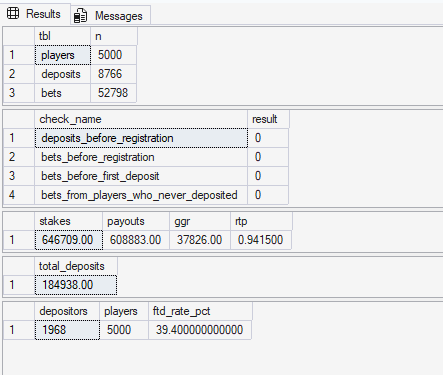
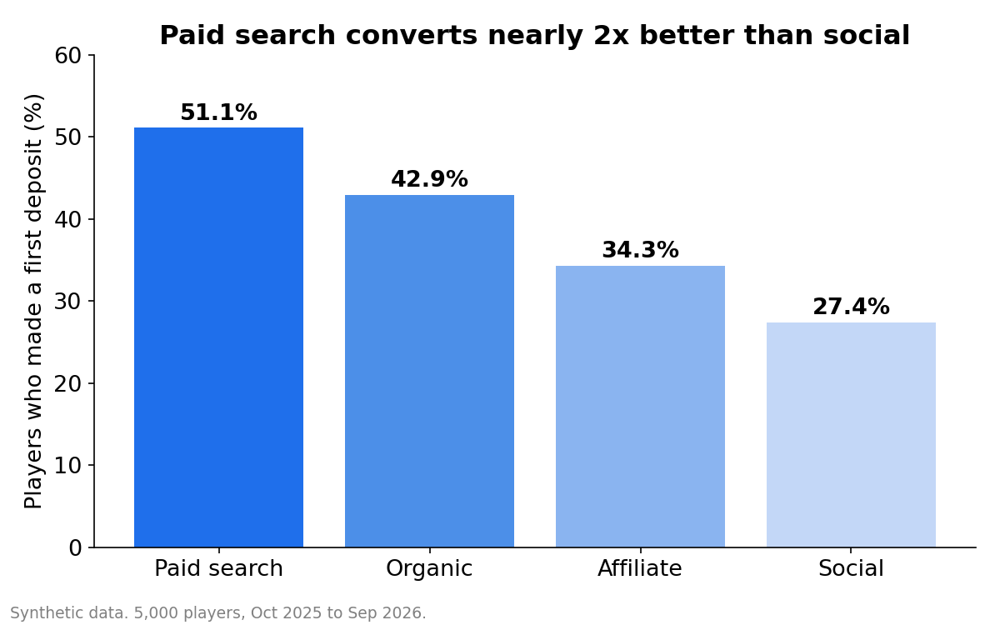
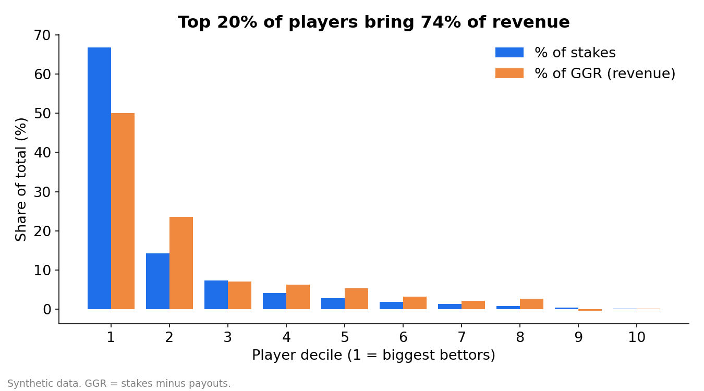
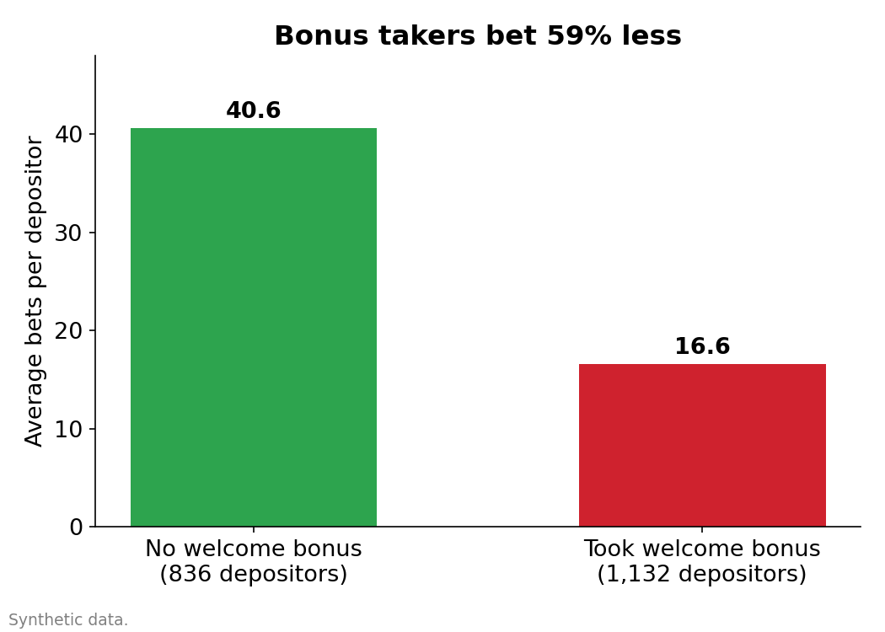

# Synthetic iGaming Player Data: a practice dataset for retention, segmentation and bonus analysis

> **One-line summary:** A realistic but fake customer database for an online casino and sportsbook, built so analytics and CRM questions can be tested safely.



**ALL DATA IS SYNTHETIC (artificially generated). No real player or company is described.**

---

## 1. The problem

**Who has the pain:** CRM and analytics teams, and analysts learning iGaming.
**What it costs:** Real player data is private and regulated, so it can't be shared or practised on. Without a realistic stand-in, methods like retention tracking or bonus-ROI analysis are either untested or tested on live data.

## 2. The data

- **Source:** generated by a Python script (fixed random seed 42, so it can be reproduced exactly).
- **Size:** 5,000 players, 8,766 deposits, 52,798 bets; 1 Oct 2025 to 30 Sep 2026; amounts in EUR.
- **Synthetic?** **Yes.** Behaviour patterns were planted on purpose (see Findings), so results describe my design, not the real world.

## 3. The approach

1. Defined three linked tables: players, deposits, bets.
2. Generated players with fictional country, acquisition channel and device mixes.
3. Gave each depositor their own habits: how often they bet, how fast they lose interest, typical bet size.
4. Built deposits and bets day by day, with a built-in house edge (casino returns ~95% of stakes, sportsbook ~93%).
5. Loaded everything into SQL Server and ran checks: no impossible dates, no broken links, revenue positive.

## 4. The findings (patterns planted by design, confirmed in SQL)

**Finding 1: 39.4% of registered players make a deposit**

Most sign-ups never pay; paid search converts best (about 51%) and social worst (about 27%). [FTD (first-time deposit) rate = share of registrants who ever deposit.]

**Finding 2: the top 10% of bettors place 67% of stakes but only 50% of GGR**

A small group carries the business, which is why VIP retention matters. [GGR (gross gaming revenue) = stakes minus payouts.]

**Finding 3: welcome-bonus players place 16.6 bets each vs 40.6 for others**

Bonus takers fade quickly, so bonus cost may not pay back. This is the question for the bonus-ROI project.

## 5. The recommendation

| Priority | Action | Expected impact |
|---|---|---|
| 1 | Run cohort retention (D1/D7/D30) split by bonus vs no bonus | Shows when and how fast bonus players leave |
| 2 | Segment players with RFM [recency, frequency, monetary value] | Gives CRM a ranked list of who to contact first |
| 3 | Build a KPI dashboard (GGR, FTD rate, active players) | One view of business health by channel and country |

## 6. Limitations and next steps

- **What the data can't tell us:** real-world behaviour. It has no withdrawals, no multi-accounting, and bonuses are a flag only.
- **With more time I would:** add withdrawals and bonus balances, then build the retention and RFM projects on this dataset.

## 7. Technical appendix

- **Tools:** Python (pandas, numpy), SQL Server Express + SSMS, Excel.
- **SQL highlights:** validation queries, CTEs, window functions (`ROW_NUMBER`, `NTILE`), conditional aggregation.
- **Code:** see [`/sql`](sql/) and [`/python`](python/).

## Repo structure

```
/data     players.csv, deposits.csv, bets.csv, igaming_synthetic_data.xlsx
/sql      01_create_and_load.sql, 02_validation_checks.sql, 03_first_kpis.sql
/python   generate_igaming_data.py, build_workbook.py, build_sql_loader.py
/docs     screenshots, charts, PROJECT_GUIDE.md
```
